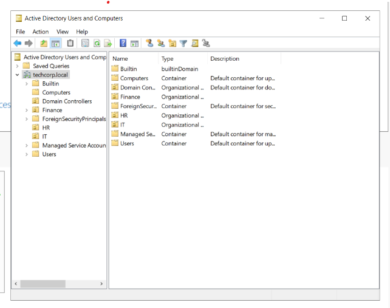
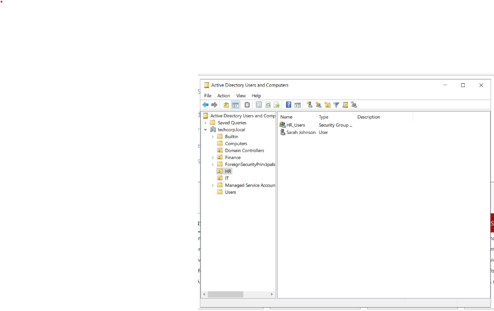
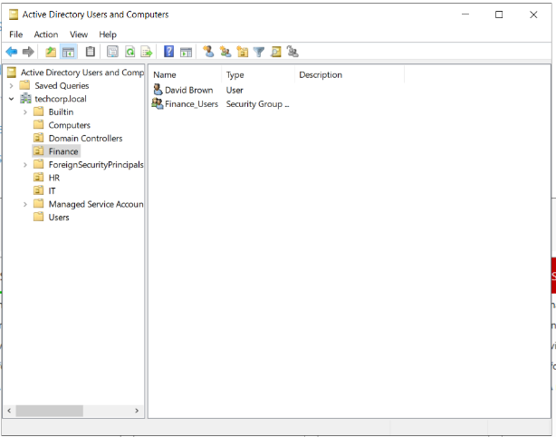
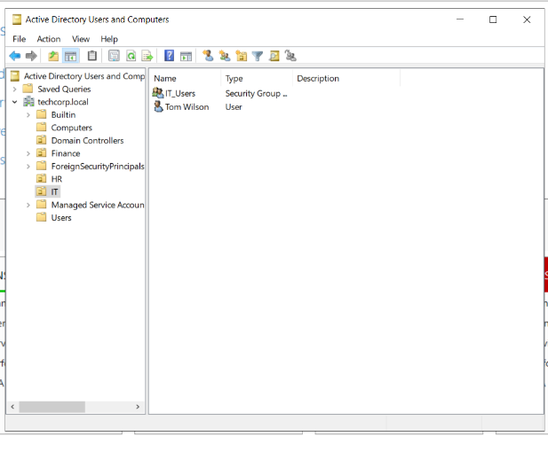
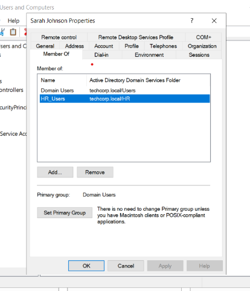
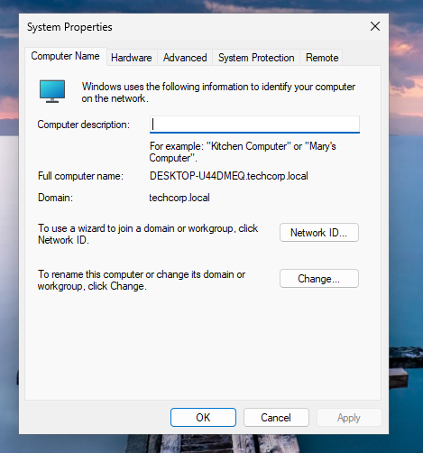
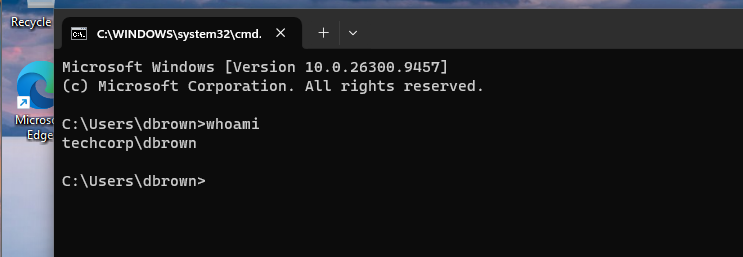

# Active Directory Home Lab 

## Objective 
To deploy a Windows Active Directory environment and perform common HelpDesk administration tasks including user account management, password resets, account enabled/disablement and domain joining.  

## Environment 
- VMware Workstation 
- Windows Server 2022
- Client Device: Windows 11 Enterprise 
- Domain: techcorp.local 

## Tasks Completed 
- Configured a static IP address on the Domain Controller 
- Installed Active Directory Domain Services (AD DS) 
- Created the techcorp.local domain 
- Created organisational units (HR, Finance, IT)
- Created users and security groups 
- Joined a Windows 11 client to the domain 
- Logged in using domain user accounts 
- Reset user passwords 
- Disabled and re-enabled user accounts 

## Skills Demonstrated 
- Active Directory administration
- User account management 
- Domain joins 
- Password management 
- DNS configuration 

## Screenshots 
### Active Directory Structure

### HR Users and Groups

### Finance Users and Groups

### IT Users and Groups

### User Group Membership

### Domain Joined Client

### Domain User Login

## Lessons Learned 
- Active Directory relies heavily on DNS 
- Domain-joined devices must use the Domain Controller as their DNS server 
- Security groups simplify permission management 
- Password resets and account administration are common Help Desk responsibilities.
- Active Directory makes centralised user management possible across multiple devices. 

## Reflection 
This project provided hands-on experience deploying and administering a Windows Active Directory environment. I successfully created a domain, managed users and security groups, joined a Windows 11 workstation to the domain, and performed common Service Desk tasks such as password resets and account administration.
