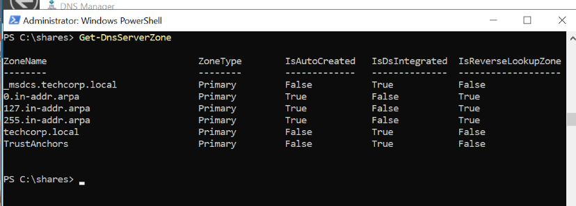
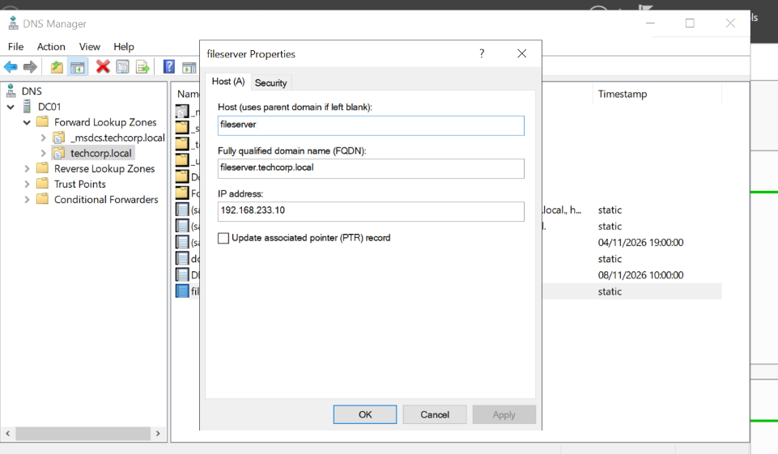
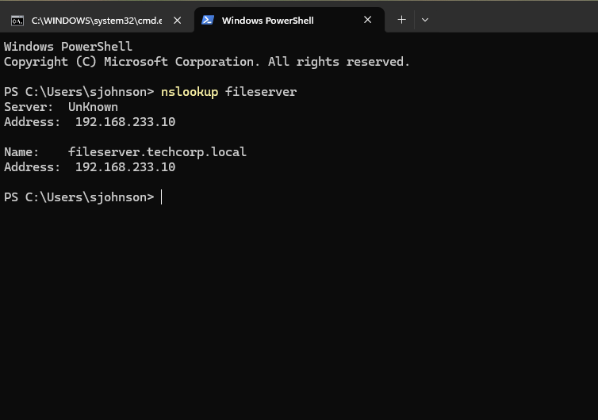
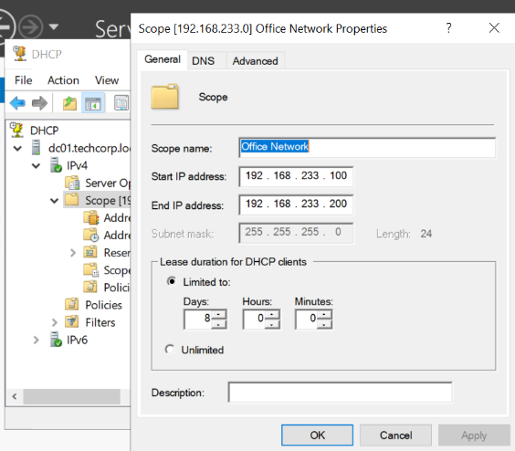
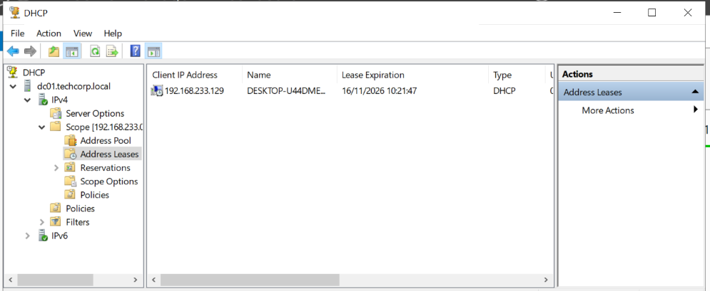
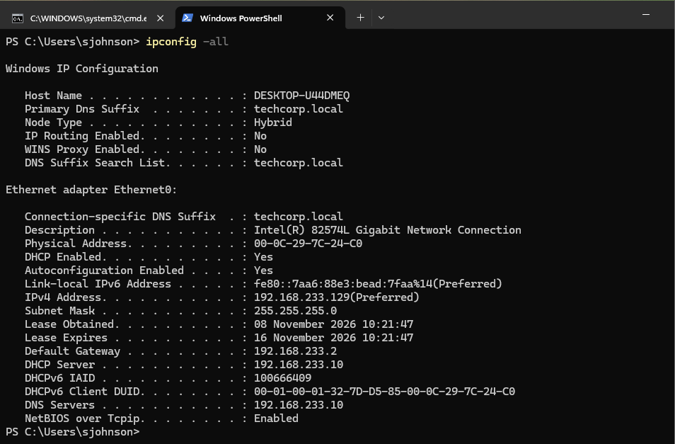

# DNS & DHCP Lab 
## Objective 
To configure and manage DNS and DHCP services in a Windows Server environment, and to understand how clients use these services for name resolution and automatic network configuration 

## Environment 
- VMware Workstation 
- Windows Server 2022
- Client: Windows 11 Enterprise 
- Domain: techcorp.local 
 
## Tasks Completed 
- Explored DNS zones created during Active Directory deployment
- Investigated forward and reverse lookup zones
- Created a DNS A record for fileserver.techcorp.local
- Tested name resolution using nslookup
- Demonstrated the impact of incorrect DNS configuration on domain resources
- Installed the DHCP Server role
- Authorised DHCP in Active Directory
- Created a DHCP scope
- Configured gateway and DNS options
- Configured a client to obtain network settings automatically
- Obtained an IP address from DHCP
- Verified active DHCP leases

## Skills Demonstrated 
- DNS administration
- DHCP administration
- Name resolution troubleshooting
- IP address management
- Active Directory integration
- Network troubleshooting
- Client configuration
- PowerShell and Windows Server administration

## Screenshots 

### DNS Forward Lookup Zone

### DNS A Record

### Successful Name Resolution

### DHCP Scope Configuration)

### DHCP Address Lease

### Client DHCP Configuration

## Lessons Learned 
- DNS is critical to Active Directory functionality.
- Domain-joined devices must be able to communicate with the internal DNS server.
- A records map hostnames to IP addresses.
- DHCP automates client network configuration.
- DHCP scopes define the range of addresses available for clients.
- Incorrect DNS settings can prevent access to domain resources even when network connectivity exists.
- Static addresses should be kept outside DHCP scopes to avoid IP address conflicts.

## Reflection
This project improved my understanding of how DNS and DHCP operate within a Windows domain environment. I configured both services, created DNS records, deployed a DHCP scope and tested client connectivity. I also simulated a DNS misconfiguration and observed how it affected access to Active Directory resources, improving my troubleshooting skills.

