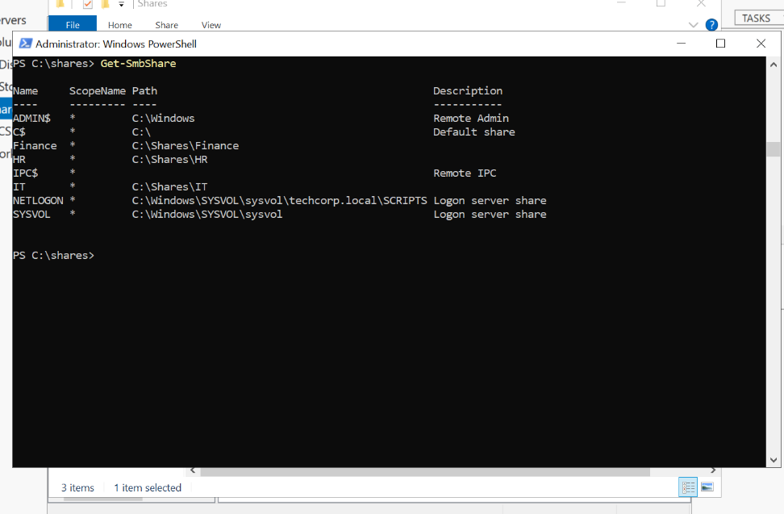
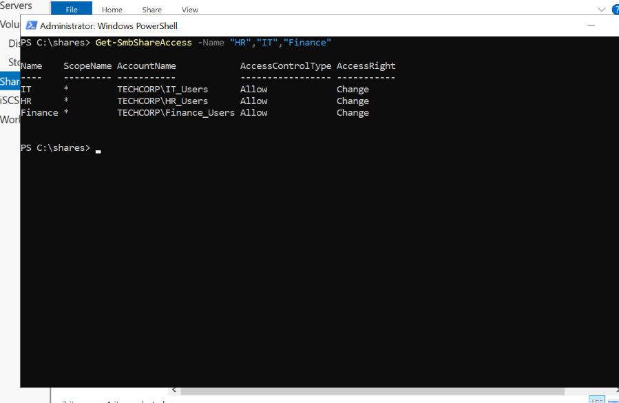
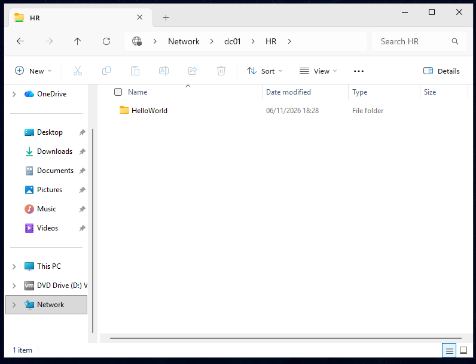
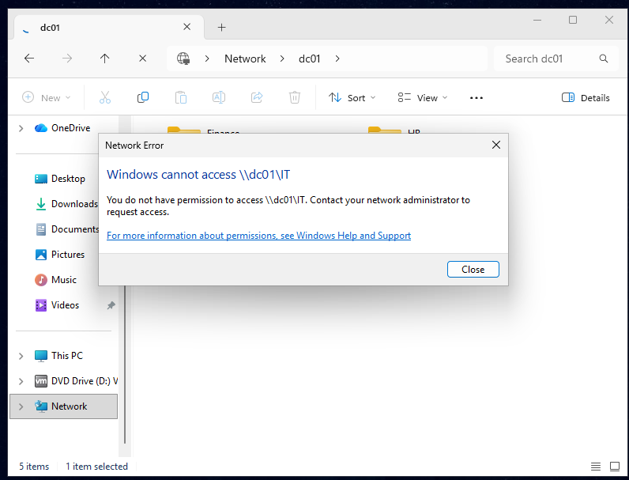

# File Share Permissions Lab 
## Objective 
To Create Departmental file shares and manage access using Active Directory security groups and SMB share permissions. 

## Environment 
- VMware Workstation
- Windows Server 2022
- Client Device: Windows 11 Enterprise
- Domain: techcorp.local

## Tasks Completed 
- Created departmental folders for HR, Finance and IT
- Created SMB shares for each department using PowerShell
- Verified share creation using PowerShell
- Reviewed default share permissions
- Removed overly permissive access assignments
- Granted access using Active Directory security groups
- Tested access from a domain-joined Windows 11 client
- Verified authorised access to departmental shares
- Verified unauthorised users received Access Denied errors

## Skills Demonstrated  
- SMB Share administration
- Active Directory Security groups 
- Share permission management  
- Access control 
- PowerShell administration 
- Troubleshooting file share access 

## Screenshots 

### SMB Shares 
 

### Departments Share Permissions 

### Successful Access to HR Share

### Access Denied to IT Share

## Lessons Learned 

- SMB enables network file sharing between devices. 
- Share permissions control access to resources over the network. 
- Security groups scale better than assigning permissions to individual users.
- PowerShell can be used to manage shares and permissions. 

## Reflection

This project provided practical experience creating and managing file shares in a Windows Server environment. I used PowerShell to create SMB shares, assign permissions using Active Directory security groups and verify access from a domain-joined client. I also tested unauthorised access scenarios to understand how permissions are enforced within a business environment.

