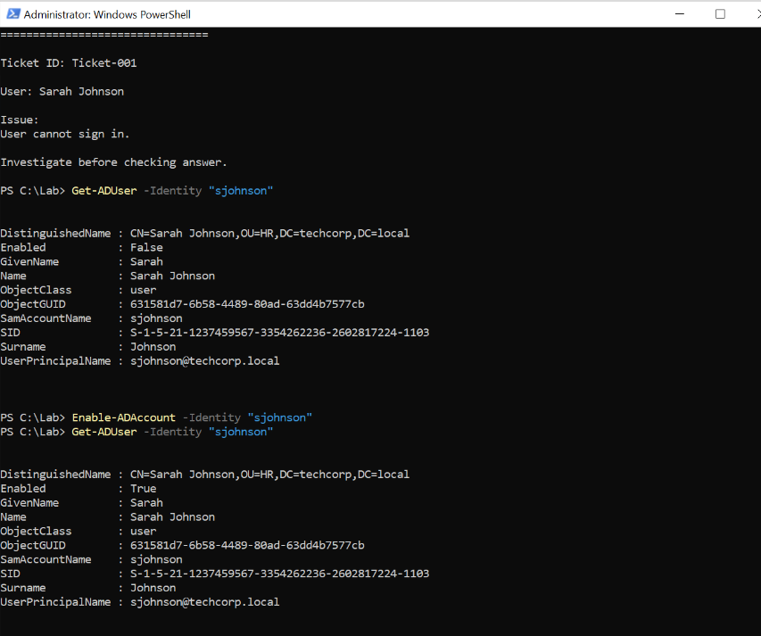

# Ticket 001 - Disabled Account

## Issue

User unable to access company resources.

## Symptoms

- User was unable to log into Windows.
- User reported they could not sign in to their workstation.

## Hypothesis

- User account is disabled.
- User account is locked.

## Investigation

- Attempted to log in using the user's credentials.
- Received an "Account Disabled" message.
- Queried the user account in Active Directory using PowerShell.
- Confirmed the account was disabled.

## Root Cause

The user's Active Directory account had been disabled.

## Resolution

- Re-enabled the user account using:

```powershell
Enable-ADAccount -Identity "sjohnson"
```

## Verification

- Verified the account status changed from disabled to enabled.
- Successfully logged in with the user account.
- Confirmed access to the workstation was restored.

## Evidence



## Lessons Learned

- Error messages should always be reviewed before beginning further troubleshooting.
- A disabled Active Directory account prevents authentication even when the password is correct.
- Verifying account status can quickly eliminate other potential causes such as password or connectivity issues.
