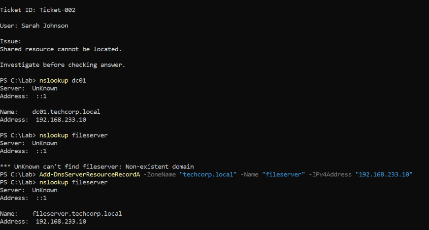

# Ticket 002 - Missing DNS Record

## Issue

Shared resource cannot be located.

## Symptoms

- User was able to successfully access other domain resources.
- `nslookup dc01` successfully resolved to the Domain Controller.
- `nslookup fileserver` returned a "Non-existent domain" error.
- User was unable to locate the shared resource hosted on fileserver.

## Hypothesis

The DNS A record for fileserver has been removed from the DNS zone.

## Investigation

- Verified connectivity to the domain environment by resolving `dc01`.
- Tested name resolution for fileserver using `nslookup`.
- Confirmed that fileserver could not be resolved.
- Investigated the DNS zone configuration on the DNS server.
- Confirmed the DNS A record for fileserver was missing.

## Root Cause

The DNS A record for fileserver had been removed from the DNS zone.

## Resolution

Recreated the DNS A record for fileserver using PowerShell:

```powershell
Add-DnsServerResourceRecordA `
    -ZoneName "techcorp.local" `
    -Name "fileserver" `
    -IPv4Address "192.168.233.10"
```

## Verification

- Confirmed `nslookup fileserver` successfully resolved the hostname.
- Verified fileserver resolved to the correct IP address.
- Confirmed the user could locate and access the shared resource.

## Evidence



## Lessons Learned

- DNS issues can prevent access to resources even when the server itself remains operational.
- Verifying name resolution early can quickly distinguish DNS issues from permissions or connectivity problems.
- Tools such as `nslookup` are valuable for troubleshooting resource location issues within a Windows domain environment.
