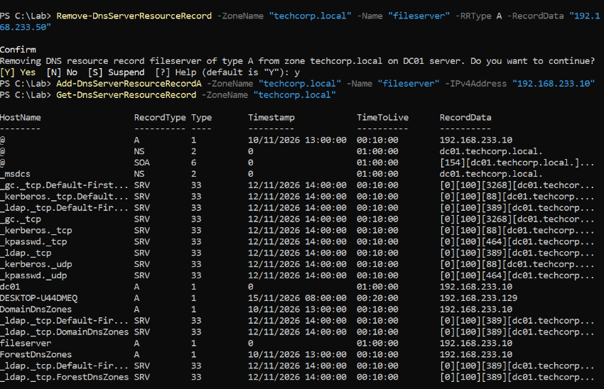

# Ticket 003 - Incorrect DNS Record

## Issue

Shared resource cannot be located.

## Symptoms

- User was unable to locate shared resources hosted on fileserver.
- Connectivity to the domain environment remained operational.
- The fileserver hostname resolved successfully but directed users to the wrong destination.

## Hypothesis

The DNS A record for fileserver exists but is incorrectly configured.

## Investigation

- Verified connectivity to the domain environment.
- Performed an `nslookup` for fileserver.
- Observed that fileserver resolved to an unexpected IP address.
- Reviewed the DNS zone configuration on the DNS server.
- Confirmed the DNS A record for fileserver pointed to an incorrect IP address.

## Root Cause

The DNS A record for fileserver was configured with the wrong IP address.

## Resolution

Removed the incorrect DNS record and recreated it with the correct IP address using PowerShell:

```powershell
Remove-DnsServerResourceRecord `
    -ZoneName "techcorp.local" `
    -Name "fileserver" `
    -RRType A

Add-DnsServerResourceRecordA `
    -ZoneName "techcorp.local" `
    -Name "fileserver" `
    -IPv4Address "192.168.233.10"
```

## Verification

- Verified fileserver resolved to the correct IP address.
- Confirmed the DNS record was present within the DNS zone.
- Confirmed users could successfully locate and access shared resources.

## Evidence



## Lessons Learned

- DNS issues are not always caused by missing records.
- Incorrect DNS records can be more difficult to troubleshoot because name resolution continues to function while directing clients to the wrong destination.
- DNS records should always be verified when investigating resource location issues.
