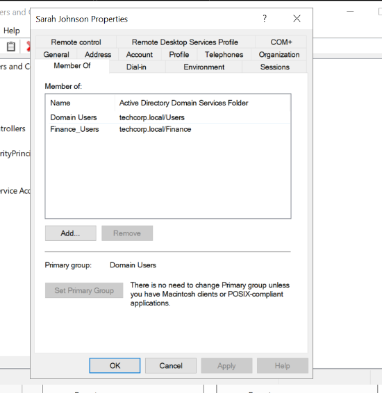

# Ticket 004 - Incorrect Group Membership

## Issue

User cannot access departmental resources.

## Symptoms

- User can successfully log into Windows.
- User can access the fileserver.
- User receives an "Access Denied" message when attempting to access the HR shared folder.

## Hypothesis

The user has been removed from the HR_Users security group.

## Investigation

- Logged into the user's account.
- Verified access to fileserver.
- Attempted to access the HR shared folder and received an "Access Denied" message.
- Checked the user's Active Directory group memberships.
- Confirmed the user was not a member of HR_Users.
- Observed the user had been assigned to Finance_Users instead of HR_Users.

## Root Cause

The user was assigned to the incorrect security group. The account was a member of Finance_Users instead of HR_Users.

## Resolution

- Removed the user from the Finance_Users security group.
- Added the user to the HR_Users security group.

## Verification

- Signed the user out and back in to refresh group membership.
- Verified the user was now a member of HR_Users.
- Confirmed access to the HR shared folder was restored.

## Evidence

## Lessons Learned

- It is important to verify all group memberships rather than only checking whether a user belongs to the expected group.
- Incorrect group assignments can result in resource access issues even when user accounts and share permissions are configured correctly.
- Group membership changes may require a user to sign out and sign back in before new permissions take effect.
