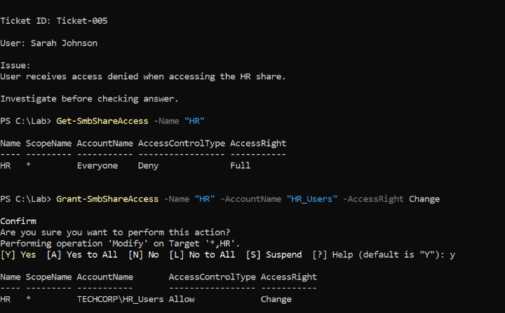

# Ticket 005 - Share Permission Removed

## Issue

User receives an "Access Denied" message when attempting to access the HR share.

## Symptoms

- User can successfully log into Windows.
- User is able to access other network resources.
- User receives an "Access Denied" message when attempting to access the HR shared folder.

## Hypothesis

- User is not a member of the HR_Users security group.
- SMB share permissions have been removed from the HR share.

## Investigation

- Logged into the user's account.
- Attempted to access the HR shared folder and received an "Access Denied" message.
- Checked the user's Active Directory group memberships.
- Confirmed the user remained a member of HR_Users.
- Reviewed SMB share permissions for the HR share.
- Confirmed the HR_Users permission had been removed from the HR share.

## Root Cause

The HR_Users SMB share permission had been removed from the HR share.

## Resolution

Restored SMB share permissions for HR_Users using PowerShell:

```powershell
Grant-SmbShareAccess `
    -Name "HR" `
    -AccountName "HR_Users" `
    -AccessRight Change
```

## Verification

- Verified the HR_Users permission was present on the share.
- Confirmed the user could successfully access the HR shared folder.
- Confirmed access to departmental resources was restored.

## Evidence



## Lessons Learned

- Share permissions should be reviewed when users receive access denied messages despite being members of the correct security groups.
- Validating group membership before modifying permissions helps narrow down the root cause.
- Troubleshooting is more effective when user-specific issues are ruled out before investigating shared resources.
