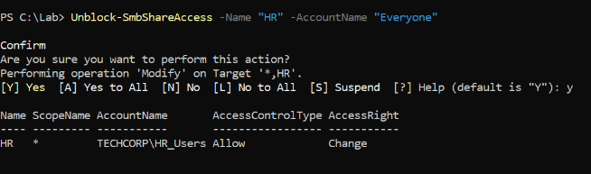

# Ticket 006 - Explicit Deny Permission

## Issue

User receives an "Access Denied" message when attempting to access the HR share.

## Symptoms

- User can successfully log into Windows.
- User is a member of the HR_Users security group.
- User receives an "Access Denied" message when attempting to access the HR shared folder.

## Hypothesis

- User has been removed from the HR_Users security group.
- An incorrect permission has been applied to the HR share.

## Investigation

- Logged into the user's account.
- Attempted to access the HR shared folder and received an "Access Denied" message.
- Checked the user's Active Directory group memberships.
- Confirmed the user remained a member of HR_Users.
- Reviewed SMB share permissions on the HR share.
- Identified an explicit Deny permission applied to the Everyone group.

## Root Cause

An explicit Deny permission had been applied to the Everyone group on the HR share, overriding the Allow permissions assigned to HR_Users.

## Resolution

Removed the explicit Deny permission using PowerShell:

```powershell
Unblock-SmbShareAccess `
    -Name "HR" `
    -AccountName "Everyone"
```

## Verification

- Verified the Deny permission had been removed.
- Confirmed the HR_Users group retained Change permissions.
- Confirmed the user could successfully access the HR shared folder.

## Evidence



## Lessons Learned

- Explicit Deny permissions take precedence over Allow permissions.
- Users may still be denied access even when they belong to the correct security group.
- Permission issues should be investigated systematically by validating user membership before reviewing resource permissions.
- Multiple hypotheses and systematically collecting evidence help narrow down the root cause.
