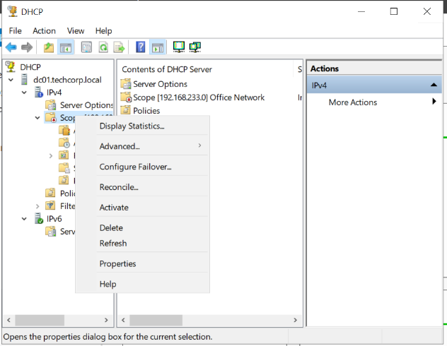

# Ticket 007 - DHCP Scope Disabled

## Issue

New workstation unable to obtain an IP address.

## Symptoms

- Client was unable to obtain a valid IPv4 address automatically.
- Renewing the DHCP lease resulted in an automatic private IP address (APIPA).
- The client could not obtain network configuration from the DHCP server.

## Hypothesis

The DHCP server scope is inactive and is no longer issuing IP addresses to clients.

## Investigation

- Attempted to renew the client's DHCP lease.
- Observed the client failed to obtain a valid address from the configured scope.
- Opened the DHCP management console.
- Reviewed the status of the configured IPv4 scope.
- Confirmed the scope state was inactive.

## Root Cause

The DHCP scope had been deactivated, preventing the DHCP server from issuing IP addresses to clients.

## Resolution

Reactivated the DHCP scope using the DHCP management console.

## Verification

- Confirmed the DHCP scope state changed to Active.
- Successfully renewed the client DHCP lease.
- Verified the client received a valid IP address from the configured scope.
- Confirmed network connectivity was restored.

## Evidence

## Lessons Learned

- Clients cannot obtain DHCP leases from an inactive scope even when the DHCP service itself is running.
- Reviewing scope status should be part of the troubleshooting process whenever devices fail to obtain IP addresses automatically.
- DHCP issues can often be isolated by verifying lease assignment and scope state before investigating client-side configuration.
